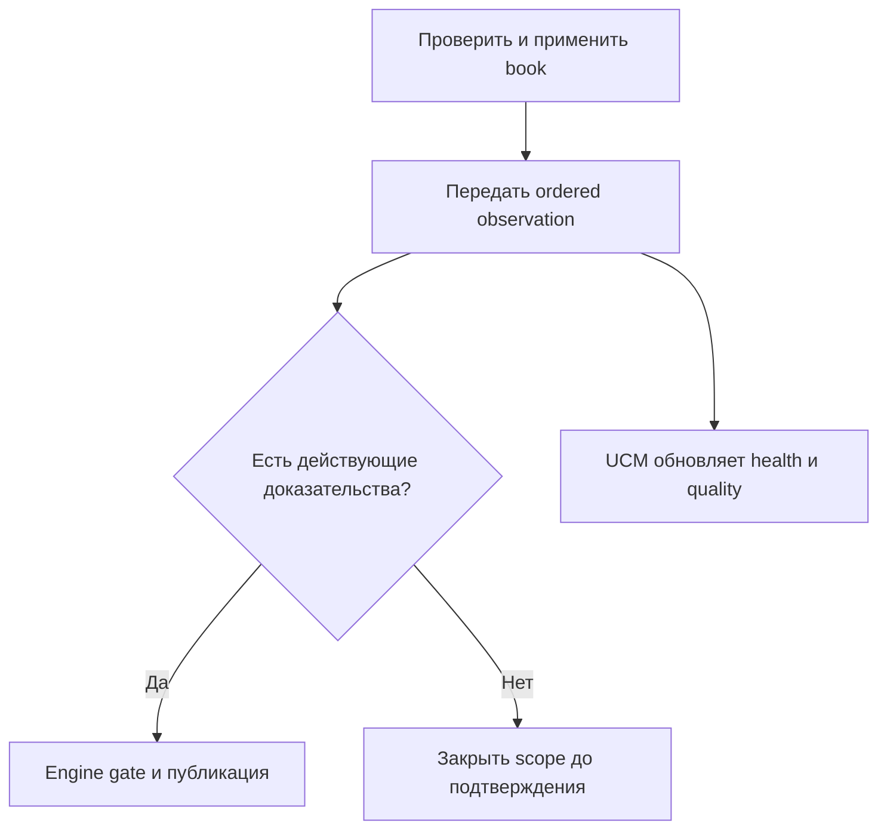
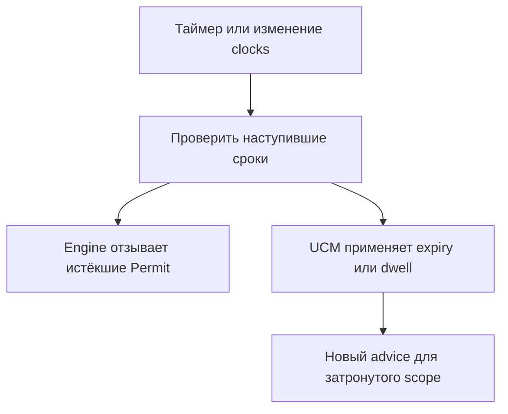
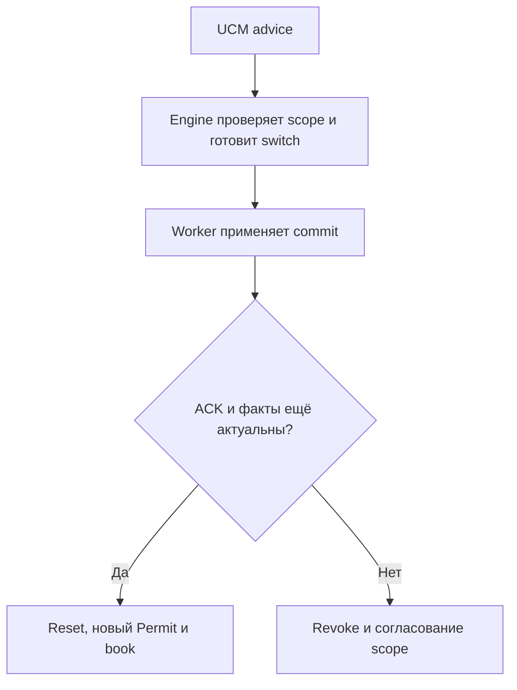
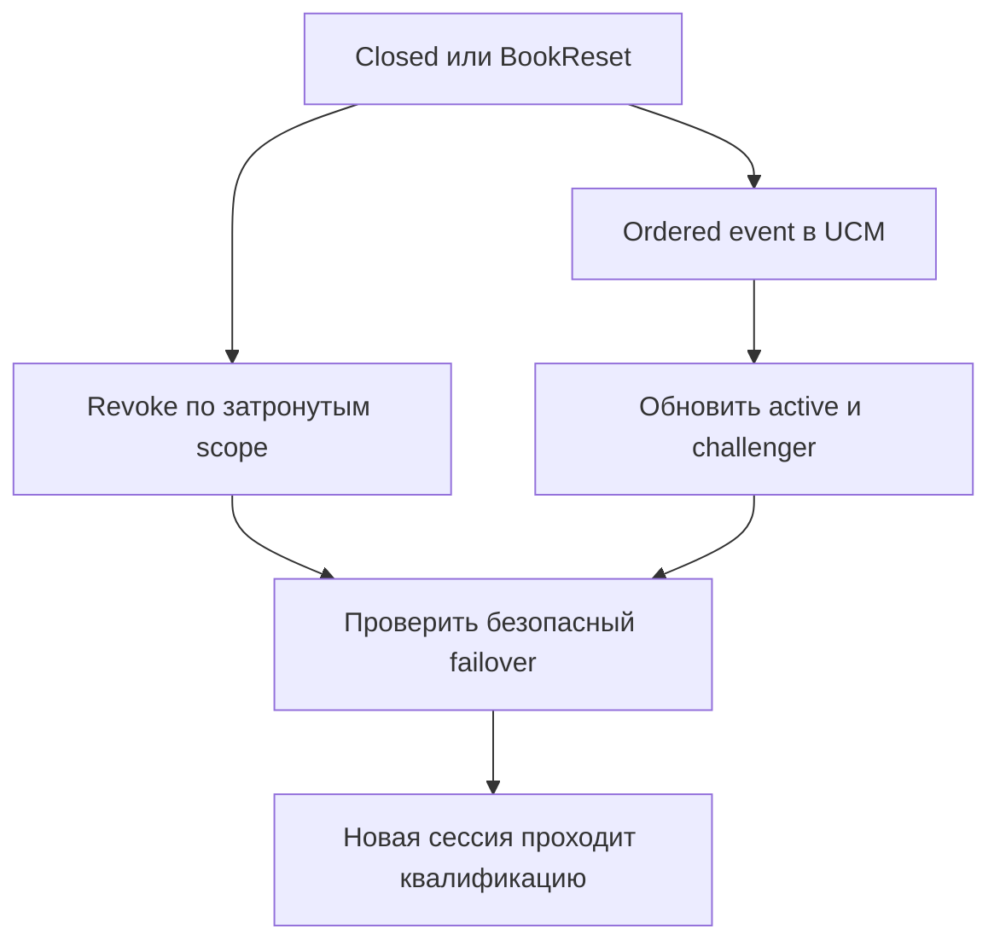

# SPOT-ARB R1403 — независимый архитектурный аудит Engine и UCM

24 ноября 2026. READ-ONLY. Аудит завершён. P0 открыт, архитектурный переход предложен к согласованию. REAL OFF, kill ENGAGED, PAPER NO-GO.

## Вывод

После выделения UCM перенеслось исполнение выбора, но сохранился прежний способ управлять им. Engine по котировке и периодическому Tick инициирует переоценку, аннулирует действующий Permit, повторно собирает кандидатов и ждёт цепочку ответов сразу для всех инструментов. UCM параллельно ведёт собственные lifecycle, качество, квалификацию и время жизни. Поэтому снижение числа команд в R1402K оставило три причины задержки: глобальное ожидание, повторные проходы по одним и тем же данным и зависимость обычной публикации от новой процедуры выбора.

Рекомендуется оставить один Engine, одного владельца UCM и существующие каналы. UCM пересчитывает затронутый scope по упорядоченным событиям и срокам, публикуя допуск источников и предложение при значимом переходе. Engine применяет обязательные события без ожидания диагностики, ведёт собственный рыночный state и немедленно проверяет текущие доказательства обычной публикации. Реальная смена источника сохраняет отдельный applied ACK. Незавершённая транзакция ограничена своим scope.

Есть самостоятельный блокирующий вопрос для изменения поведения. Текущий Engine способен принять и затем заменить уникальное состояние до Decision. Спецификация требует event-driven по инструменту и decision-by-decision parity. До проверки нельзя разрешать latest-only для торговых входов или признавать все такие замены безвредными.

## Контур проверки и источники

- Checkout `/mnt/spotarb_db_test/r1273_r1275_engine_latency_20261111/source`, ветка `work/r1273-receive-batch-instrumentation-20261111`, HEAD `6d4d403c35e4893224c8f0f0541718ec831fa2dd`. Аудит относится к фактическому рабочему дереву R1402L, с унаследованными 15 изменёнными и 17 untracked путями. Публикационный бинарник R1402I по handoff старше этих исходников.
- Прочитаны актуальные записи START_HERE, WORK_RULES, MASTER_SPEC, DECISIONS, CURRENT_STATE, DEFECT_REGISTER, NEXT_ACTIONS, WORK_LOG, CHANGE_LOG, общий handoff и исторические документы 27, 28, 30, 36, 37, 52, 53, 56 и 57. Сверены R1320 recovery, оригинальный [Global Master Spec 2026-10-01](https://chatgpt.com/library?file_id=libfile_943cba5e1cd48191a458752978f0e5ff&account_id=personal), действующее решение 18 ноября по новым событиям RAM-first и R1399 по единственному UCM worker.
- Ссылки вида E:NN ссылаются на строки фактического дерева, внутри `native_market_core/src/`. E — `market_data_ingress_r1205.rs`, U — `universal_connection_manager_r1209.rs`, R — `ingress_runtime_r1205.rs`, P — `market_data_processor_r1378.rs`, S — `r1354_deadline_scheduler.rs`, B — `native_paper_bridge_r1301.rs`, I — `native_paper_integrated_r1325.rs`.
- Исторический лог R1402L_FORENSIC.log и exit=0 показывают 2/2 characterization PASS. Это воспроизведение текущего поведения: ETH остаётся без Permit при здоровом owner-side dual-HOT во время продолжения BTC, а 12 закрытых поколений и одно текущее остаются в owner и публикации после Tick. R1403 тесты, Cargo, сборки и сетевые прогоны не запускал. Свежесть и latency результата предлагаемой архитектуры не измерялись.

## Фактическая карта исполнения

При opt-in `R1402_UCM_WORKER=1` UCM передаётся одному worker. Этот путь ограничен volatile quote runtime. Без opt-in Engine использует локального менеджера, а запуск worker с durable Store отклоняется. Выводы о глобальном continuation относятся к worker-пути. Торговой parity из quote-only прогонов вывести нельзя. R:511–534, E:1545–1568.

| Событие | Вызовы и фактический владелец | Данные и обязательные проверки |
|---|---|---|
| Валидная котировка | Reader → Queue16 → существующий Forwarder/P::prepare_forwarded → существующая Queue32 → E::receive_batch_inner. P готовит JSON, update и цепочку OKX L2. E валидирует и заменяет SourceBook, посылает Observe(true), запускает select по затронутым scope в конце batch. Worker select снимает Permit и помечает scope dirty. | Engine владеет принятой цепочкой, SourceBook, witness, highwater и допуском. Проверяет доверенный предшественник, категорию источника, оба возраста, sequence, cross-feed conflict. UCM получает факт для health, времён, качества и квалификации. R:545–561, 636–658, P:43–74, E:1070–1182, 1545–1562, U:157–171. |
| Невалидная котировка | Диспетчер ветвится. Stale известного источника вызывает Observe(false) и терминализацию, ошибка OKX L2 может вызвать BookReset, resync и re-subscribe, конфликт идентичности ведёт к карантину. Дубликат/reorder и неподдерживаемый вход имеют отдельные ветки, общий Observe(false) для всех отсутствует. OKX keepalive проходит как транспортное событие. | Сохраняются правила по категориям. Подтверждённый ещё свежий book может пережить отдельное stale-сообщение, пока пройдены все остальные предикаты. Reorder/duplicate-ветка сейчас отзывает witness, это отдельная семантика, которую нужно сверять до изменений. Keepalive не продлевает книгу. E:947, 1047–1058, 1074–1105, 1107–1143, U:157–180. |
| Периодический Tick | Runtime вызывает E::tick_inner примерно каждые 50 мс. Engine отправляет Tick, K проводит producer-side scope/source proof, owner перебирает sources и refresh_tick перебирает их снова. Engine обходит universe, повторно проверяет readiness и stable choice или запускает select. | UCM обновляет freshness/qualification/lifecycle. Engine обязан поддерживать собственный срок допуска, но полный обход и повторная election не являются требованиями финального gate. R:571–612, E:1770–1820, U:222–235, 366–382, 886–905. |
| Выбор активного источника | E::poll_ucm_worker_inner по одному scope. Published → при изменении readiness History → Certified или Proposal. E строит упорядоченное множество допустимых с учётом book/readiness/highwater. U::choose_candidate_with_quality применяет исходную политику качества, tie-break и challenger. | UCM — единственный владелец оценки качества, challenger и worker-active. Engine владеет допустимостью книги для публикации. Published и состояние, которое Engine успел установить с нужной ревизией, различаются. E:165–175, 1268–1317, 1344–1457, 1493–1516, 1574–1623, U:196–215, 811–846. |
| Переключение | При прежнем active E идёт в финальную публикацию без commit. При смене E готовит план и epoch → UCM применяет commit → E проверяет ACK/текущий view и публикует Reset по принятой границе. Superseded ACK оставляет scope закрытым и требует согласования актуальных состояний. | Epoch, Reset, Permit, highwater — Engine. UCM подтверждает реальное изменение active. Сверяются prior, выбранный source, current candidate/book identity, ревизия, готовность и свежесть в момент публикации. E:1450–1484, 1520–1543, 1624–1670, 1708–1756. |
| Закрытие и восстановление | Runtime подаёт Connected/Subscribed/Closed, новый socket создаёт уникальную session. Сейчас E::disconnected помечает session и книги Degraded, вызывает глобальный tick, отправляет групповое Close, убирает книги и связанные структуры с revoke witness. UCM сбрасывает active/challenger. | Scope охватывает все инструменты физической сессии, зависимые Permit отзываются по факту. Новый generation заново проходит подписку, snapshot/цепочку и квалификацию. Проверить отдельно гонку двух фаз close и in-flight downstream. R:297, 614–618, E:387–425, 725–739, 1822–1829, U:150–155, 219. |
| Передача в Decision | E::finish_hot_publication проверяет текущие книги, пишет Permit, а при advancing highwater или точном equivalent failover формирует Output::Frame/Book. Runtime перед отправкой ведёт summary; затем ждёт existing out.reserve. Потребитель quote-only принимает Output, торговый bridge отдельно проверяет authority, witness и freshness. В интегрированном пути provider.accept → typed observe_inner → Decision/Risk. | Engine Output сам по себе ещё не принят Decision. Reset должен предшествовать новой книге данного scope. B::revalidate_at сверяет session, selection epoch, standby и текущий witness. Owner/Decision перепроверяет пару, положительный допуск остаётся под Risk/Safety и durable intent. E:1708–1756, R:662–683, B:122–151, 194–223, I:81–97, 232–292. |

Scope Engine — venue/base, scope UCM включает exchange/segment/instrument/channel. При интеграции отображение должно оставаться однозначным с фактическим SourceId и правилами channel mismatch (E:55, 1079–1080). Независимость BTC/ETH относится к продолжениям управления. Две площадки одного base по-прежнему связаны в Decision, единый FIFO источника и глобальные ошибки целостности продолжают иметь своё действие.

## Подтверждённые дефекты и границы доказательств

| Дефект | Доказательство и воздействие |
|---|---|
| Глобальный head-of-line | E:316, 1344–1380, 1386–1489. Одна Option обслуживает несколько фаз; round-robin работает только после завершения выбранного scope. Ожидаемая history-retirement/census блокирует продвижение дополнительно. Сами ordered Observe и приём книг могут продолжаться. R1402L log подтверждает задержку ETH при healthy owner; доля этого эффекта в хвосте Queue32 на публичном потоке неизвестна. |
| Снятие Permit на доброкачественном пути | E:1152–1181, 1545–1562, 1803–1811. Обновление само по себе вызывает remove; новому Permit требуется повторная публикация. Отдельно E:1162–1165 отзывает прежний witness на каждом полном snapshot, включая Binance/OKX books5. Удаление одного remove сохранит лишь запись с уже отозванным witness в таких случаях. Downstream revalidation и superseded (B:122–151) подтверждают необходимость отдельного контракта преемственности. |
| Многократные проверки и сканирования | U:886–905, 222–235, 366–382, E:1770–1820. K добавляет producer proof по источникам, затем owner Tick и refresh, затем полный Engine tick. В stable check E::ready вызывается напрямую и из readiness mask (E:615–638). При обычной выборке новый turn также строит ordered sessions, candidates и standby (E:1574–1623, 1720–1727). U::refresh_source клонирует SourceHealth с окнами и вычисляет качество под общей публикацией (U:351–364). |
| Диагностика влияет на допуск и обслуживание очереди | E:271–276, 1323–1362, 1411–1420: history-ответ может удерживать continuation. E:314, 602, 816, 834–842, 1181: расчёт размера/serialization, JSON/trace, clone сырого frame в terminal path; volatile flush затем просто очищает список. R:663–669 собирает coverage/qualification JSON в единственном loop. R:675 ждёт downstream до 250 мс — граница данных, её нельзя снять как диагностику. R1395 p99 send wait около 0,026 мс в наблюдавшемся режиме. |
| Закрытые поколения накапливаются | U:150, 219, 351, 369; E:164, 235, 1298, 1822–1829. Полные health остаются в UCM и проекции, множество known пополняется, закрытая Engine session остаётся Degraded. Engine действительно удаляет книги, manager_ids, chain и resync state этой session. Результат R1402L подтверждает 12+1, скорость накопления CPU/RAM не измерена. |
| Незавершённый учёт market states | E:1149–1150, 1172–1180, 1752–1756: retained старой книги заменяется до select. Причина «standby_superseded» применяется и к ранее выбранной session. E:834–841 очищает volatile terminal записи без полного census. B:122–166 может отдельно отсеять superseded уже отправленный input. R1402J/K имели 6400 Reader=Engine inputs, 2660/1864/2673 outputs и нулевую terminal-выборку. Разность — смесь mirrored copies, квалификации, отказов в публикации и возможных уникальных состояний. Публичные и локальные quote-only результаты не проверяют Decision. |

R1395 уточняет механизм backpressure: Queue32 учитывала reserved slots, ранее в её времени ошибочно сидела подготовка Forwarder. После исправления метрики Queue16 занимала 117,765 мс из 152,262 мс средних измеренных фаз после ws.next в конкретном тяжёлом окне. Само ожидание возникает, когда центральный цикл не освобождает capacity вовремя. Это подтверждает внутренний механизм, без утверждения об исключительной причине всех задержек или возрасте при отправке биржей. R1396 показывает для этого окна 14,588 с Tick и около 29,744 с batch из 60 с. Профили вложены, складывать их с дочерними интервалами нельзя.

R1402J → K1/K2 на одном предложенном локальном WSS workload из 6400 кадров/16 сокетов/80 scope: Proposal 6662 → 2482/3996, но Tick 536,773 → 859,149/885,674 мс, Queue32 p99 4,549 → 22,027/8,101 мс. UCM service 765,595 → 774,625/670,885 мс. Расписание фактической подачи различалось; результатов недостаточно для изоляции каждого вклада. Общее улучшение не установлено. «Full universe» здесь означает 40 баз исходного набора этой fixture, покрытие 235 инструментов из результата не следует.

## Что требует спецификация

- Original Global Master Spec, разделы 3–6: события нормализуются, обновление BTC пересчитывает BTC, Decision event-driven и каноническая parity проверяется decision-by-decision. Полный обход universe на каждую периодическую проверку ради повторного выбора и зависимость BTC/ETH по continuation расходятся с этой целью. Системный watchdog и глобальная реакция на реальную общесистемную ошибку совместимы с ней.
- Тот же документ требует, чтобы отчёты и дисковая история не были синхронным шлюзом hot path. Ожидание history/census перед внешним допуском scope технически делает отчётную работу частью этого шлюза. Текущий volatile путь избегает SQLite ingress, а legacy durable obligations сохраняются по R1205 и решению 18 ноября. Блокирующие операции legacy не входят в изменения этого этапа.
- Из MASTER_SPEC и оригинала следует обязательная decision parity, bounded pressure и строгий порядок обязательной истории. Формулировки, разрешающей заменять уникальные валидированные состояния до Decision, не найдено. Стандарт lossless для durable history сам по себе не устанавливает требование Decision для каждого физического кадра. R1398/R1402 требуют точного replay для различения эквивалентных копий, отброшенных по допустимому контракту кадров и утраченных уникальных decision-eligible состояний.
- R1402 требует завершить фактическое переключение до Reset/Permit, сохранить 800 мс и dual-HOT. Отдельная проверка на выходе Engine, в Bridge/Decision и перед Risk/Safety — корректная защита разных границ. Экономить следует повторную election и сериализацию отчётов, сохраняя все проверки безопасности при фактическом использовании.

## Рекомендуемый контракт

| Обмен | Ответственность и обязательный порядок |
|---|---|
| Engine → UCM, существующий bounded FIFO | Обязательны Connected/Subscribed/Closed/Reconnect, Observe valid/rejected по исходным веткам, transport-only, BookReset, quarantine и применённые изменения допустимости. Поля: точный SourceId, epochs, scope, ordered producer revision, исходные clocks, результат проверки. Engine передаёт проверяемый отпечаток допустимости книги: identity/generation/witness, sequence/event time, eligibility относительно highwater. Изменение highwater при публикации тоже может менять eligibility standby. UCM применяет факты в исходном порядке. Gap/full/fault остаются fail-closed, события не переписываются. |
| UCM → Engine, текущая immutable публикация и Notify | Прикладное состояние по scope: applied watermark, health/HOT каждой действующей копии, причины и сроки переходов, active, нужный для ревизии отпечаток подтверждённых book facts. Отдельно версия lifecycle/eligibility для допуска и версия выбора для качества, с проверяемым доказательством совместимости. Слепой перенос старой ревизии запрещён. Coalescing уведомлений допустим только для «прочитай текущее состояние». За destructive transition нужна монотонная отметка отзыва либо наблюдаемое ordered событие, чтобы revoke→recover между чтениями не исчезли. Расширять poll на поиск по всему universe в каждом Notify не следует. |
| Предложение | UCM формирует scope advice на действующих Engine eligibility facts при старте, изменении допустимости/качества, emergency или достижении challenger dwell. Содержит candidate, scope/generation, origin revision, basis/expiry и reason. Последовательность и tie-break существующей политики сохраняются. Изменение quality может сдвинуть выбор или отменить challenger, поэтому его нельзя просто игнорировать; пересчёт идёт только по реально затронутому scope. |
| Подтверждение применения | Один ordered Commit в работе на scope при действительной смене. Проверить prior, candidate, expected revision/eligibility и actual applied ACK. Если ACK пришёл после revoke или замены, affected scope закрыт до согласования worker-active и Engine-selected. Нет повторного Reset или переноса epoch без принятого переключения. |
| Окончательный допуск | Только Engine, с actual clocks и проверкой live distinct independent sources, current connection/generation/snapshot witness, sequence/checksum/chain, selected epoch и highwater. Bridge и Decision сохраняют повторные проверки в своих точках использования. Одно продолжение на scope, ограниченное зарегистрированным множеством scope, плюс готовые к продвижению scope через существующее пробуждение. Ограничивать число готовых продолжений за turn ради fairness с Queue32, без ожидания ответа в центральном loop. |
| Диагностика | Исторические readiness transitions, если нужны для safety/replay, сохраняются упорядоченными до отделения доказательств. Сборщик читает уже применённые компактные факты через существующий диагностический путь/снимок. Receipt состояния истории и census не блокируют Permit других scope. Порог деградации, Closed, authority revoke, Reset и решение допуска остаются в обязательном контуре. |

Одна FIFO физически делит CPU и capacity: per-scope изоляция убирает ожидание чужого результата в Engine, но не устраняет mailbox residence, общий overload и необходимость системного fail-closed при поломке worker. Работа в новом варианте — обслуживание всех прежних ordered событий плюс переоценки только реально затронутых scope и наступивших сроков. Экономия достигается удалением round trips, повторных чтений масок, глобальных проходов и клонирования подробных views. Цена включает необходимые обновления eligibility при highwater, поддержание deadlines и верификацию ревизий. CPU, wall, allocations, lock wait и tail нужно измерить сквозным A/B; дополнительный core не предполагается.

### Permit при обычной котировке

Сохранять authorization основание можно для того же scope и epoch, той же выбранной и независимой standby-копии, если прежний вход сам ещё валиден, witness жив и совпадает, оба возраста каждой копии в пределах 800 мс, lifecycle и chain не менялись разрушительно, а новый ordered результат не ставит это под сомнение. При наличии допустимого более свежего доказательства Engine переустанавливает набор подтверждений атомарно. Новая котировка всё равно проходит самостоятельный финальный gate. При ожидании owner state использовать можно только основание с доказанным отсутствием неподтверждённого destructive события; при неизвестности affected scope закрывается.

Отзываются допуск и соответствующее доказательство при stale/future clocks, потере независимой standby, close/quarantine/reconnect, BookReset, mismatch/разрыве sequence/checksum, смене generation/epoch/identity, отзыве snapshot witness, несогласованном применении switch или доказанном нарушении ordered протокола. Текущие правила реакции на duplicate/reorder сохраняются до отдельной parity-проверки. Истечение одной копии не продлевается транспортным heartbeat.

Для полного snapshot на E:1162–1165 прежний token сразу становится мёртвым. Безопасный первый шаг — сохранить этот отзыв и обеспечить publication нового свидетельства без переизбрания, когда полные доказательства на месте. Если позднее требуется сохранить преемственность входов между полными snapshot, разделить proof непрерывности цепочки и identity конкретной книги только после согласования с Bridge/Decision, сравнения сигналов и fault tests. Не делать старый snapshot witness снова живым. Переход standby A→B также затрагивает queued input: текущий Bridge привязал его к standby identity.

### Потоки обработки

### Таймеры и жизненный цикл

| Работа | Триггер, владелец, ограничение |
|---|---|
| Свежесть книги и Permit | Engine, первая невалидная точка после inclusive receive+800 000 000 нс и integer wall event+800 мс у обеих копий. Проверять реальное монотонное и wall время при каждом допуске. Wall expiry при непрерывном ходе срабатывает с event+801 мс; скачок wall (в обе стороны), отрицательный возраст и переполнение требуют безопасного пересчёта/закрытия. При пропуске wake запрещён допуск по истёкшему proof. |
| Жизнь соединения | Reader/runtime: connect/subscribe, Close/transport, heartbeat и существующие пороги rotation. UCM применяет health transition для затронутых scope. События lifecycle упорядочены относительно market frames той же сессии; отдельная управляющая ветвь не должна обгонять принадлежащие ей обрабатываемые кадры. |
| Квалификация и recovery | UCM, на valid Observe с фактическими samples/elapsed/span и текущей book eligibility, либо на демоции по сроку/событию. Истечение dwell при тишине само по себе не квалифицирует источник: нынешний Observe требует соответствующий валидный образец. До cutover сверить Engine qualification state и UCM requirements по всем действующим режимам. |
| Выбор и hysteresis | UCM, на релевантное изменение health/quality/eligibility, либо через точный existing challenger dwell с актуальными фактами. Dwell начинается/сбрасывается по тем же предикатам и tie-break. Emergency при непригодности active не ждёт challenger. Сверить эффект привязки старой политики к моменту оценки каждые 50 мс, чтобы не ускорить или не отсрочить выбор молча. |
| Диагностика | Существующий период суммарного обзора/запрос или sampling, по данным уже известного состояния. Держать лёгкие монотонные timestamps и counters на месте события, а построение JSON, payload cloning и дорогое coverage/proof вынести из центральной ветки. Ведём раздельно owner applied HOT, Engine book valid, Permit available, consumer admitted и decision evaluated. |

R1354 можно использовать как основу deadline index после исправления bounds. S:6–24 оставляет старые entries в heap до срока, каждое переустановление создаёт entry; равновременный набор возвращается из HashSet без фиксированного порядка. Исторические 235 scope model и 235-scope сравнение реального Engine с нулём outputs подтверждают только механику расписания. Нужен один заменяемый deadline на существующий живой ключ/тип, либо строго ограниченная компакция stale entries с измеренным worst-case. При получении входа и обработке отзыва учитывать уже истёкшие сроки в семантически правильной последовательности относительно market/control, со стабильным tie order. Deadline index хранит расписание, не market frames или управляющие payloads. Оставить watchdog как контроль часов/просроченных deadlines; полный обход оправдан при общей аномалии часов или аварии согласованности.

Закрытие — точка немедленного revoke у затронутых scope. После обработки ordered Close и доказательства отсутствия ссылок pending/commit убрать подробный health, published view, candidate/challenger, engine known и индексы закрытой session; сохранить компактный monotonic generation floor по стабильной identity группы/слота, а также необходимые readiness history aggregate и highwater scope. Старую session нельзя зарегистрировать заново по запоздалой market frame. Если идентификаторы повторно используются, ключ и floor должны различать lineage и переживать допустимый переход/restart, либо протокол должен гарантировать flush/новый namespace. TTL без upper bound на поздний приход недостаточен. Проверить старые Observe/ACK/Tick/Close после retirement и новый scope при recycling идентификаторов.

### Полнота потока

Учитывать стадии Reader accepted, Engine valid, normalized identity, admission eligibility, selected, runtime enqueued, bridge accepted и Decision evaluated. Уникальный event ID должен опираться на source identity/generation и порядок источника, с normalized exchange event identity для cross-feed сравнения; volatile accepted_id сам по себе недостаточен. Нужны bounded RAM counters по точной причине и выборки trace. Различать mirror-equivalent, rejected/reordered, transport-only, warm/ineligible, true standby, active overwritten до публикации, downstream superseded, fail-closed on pressure и обработанные Decision. Сверять per-source и per-scope conservation на закрытом наборе событий с отдельным остатком pending; sample eviction не должен искажать счётчики.

Законная дедупликация — идентичный нормализованный market event с совпадающими book/content, каналом и биржевой identity согласно действующим правилам. Равный sequence при конфликтующем содержимом требует прежнего карантина, а equal-book failover остаётся отдельной операцией смены authority. Одинаковая цена при новом sequence/time и разные принятые OKX deltas сами по себе не доказывают эквивалентность. Каждый delta нужен для корректной цепочки независимо от будущего выбора. Сначала классифицировать фактические замены в active/standby и downstream, затем сравнить на одном детерминированном входе последовательности Decision и положительных сигналов. При обнаружении потерянного обязательного состояния продвигать его admission в исходном порядке через существующие bounded пути, с прежним backpressure/fail-closed, либо получить отдельное решение о допустимом контракте. Перенос последнего состояния в ещё один буфер ничего не доказывает.

## Альтернативы и решение по R1402K

| Вариант | Преимущество | Ограничение и вердикт |
|---|---|---|
| Только per-scope continuation поверх нынешнего query-протокола | Прямо устраняет проверенный BTC→ETH HOL, мало риска для UCM election. | Оставляет History/Proposal и полный Tick. Использовать как первый переход, сохраняя старую семантику допуска до proof. |
| Вернуть синхронный UCM и заменить Tick точными сроками | Убирает межкомпонентные round trips, проще следить за общим порядком. | Возвращает quality, lifecycle и election на единственный Engine loop, меняет согласованный worker-путь. Оценочная альтернатива, пользы на текущем контуре не доказано. |
| Один существующий worker с event-driven scoped advice и отдельным Engine gate | Убирает глобальное ожидание и запрос на обычное продолжение допуска. Сохраняет один источник lifecycle/quality и отдельную настоящую границу переключения. | Нужны ordered eligibility, bounded deadlines, proof совместимости ревизий и decision parity. Рекомендовано поэтапно в существующих типах и каналах. |

- **Сохранить** работу R1402I с автоматической owner publication и точной функцией качества. Из K сохранить forensic counters, тесты inclusive expiry и защитные условия, при которых owner признал active стабильным: тот же active, без challenger, исходные eligibility/quality и clocks. Сохранить conservative fallback, если проекция не подтверждена, и applied ACK из R1402. Exact owner quality можно проецировать компактно без копирования окон, сохранив математическую эквивалентность.
- **Переработать** K StableChoice как scoped result владельца при изменении фактов или наступлении срока. Сверять его с current Engine gate без отдельного полного ready/mask scan. Dirty coalescing оставить только как расписание одного продолжения на scope. Оно не разрешает заменить market events и не отзывает Permit само по себе.
- **Отменить при замене** producer-side certified full sweep (U:886–905) и Engine-wide per-tick stable proof scan (E:1770–1819). В новом протоколе их заменяют разделённые deadlines, ordered invalidations и финальный actual-time gate. До доказательства parity сохраняется нынешнее поведение fail-closed; простое удаление Tick или пропуск просроченного scope неприемлемы. K как целое не принят по производительности.

## Последовательность исправления и будущая приёмка

| Этап в существующем crate | Проверка перед переходом |
|---|---|
| 1. Зафиксировать текущее поведение targets. Добавить компактный RAM census, read-only измерение gate/consumer и классификацию active/standby superseded в E/R/B. | Сопоставить вход → нормализованный identity → терминальный reason → Decision, объяснить разницу outputs. Исторические witness использовать как регрессии, а не повторять прежние прогоны без цели. |
| 2. E/R: заменить глобальную Option на ограниченные scope continuations, ready-only wake и bounded fairness. Отделить retirement/census receipt от разрешения другого scope, сохраняя обязательный порядок событий. Привязать close revoke к затронутым scope до необязательной работы. | Реальный BTC/ETH сценарий с задержкой каждой фазы, simultaneous closes, history lag, front-of-line real event, worker restart/gap/full. ETH продолжает при валидных своих доказательствах, общие faults fail-closed, входной FIFO и outputs/epoch сохраняются. |
| 3. E/U/B: развести обычный refresh, отзыв и switch. Определить proof пригодности при ещё живом Permit и сохранить full-snapshot witness semantics. Подать в U scoped book eligibility, опубликовать scoped advice, заменить повторные query, оставить реальный Commit только при смене. | Точные 800/801 мс по монотонным и настенным часам, clock step назад/вперёд, независимость, blackout, resubscribe, checksum, reordered/duplicate, highwater, equal-seq failover, 5s challenger. Проверить delayed/out-of-order ACK, revoke→recover между чтениями, standby replacement и уже queued B input. Сравнить фактические Decision/epoch/Reset и риск на одном порядке входов. |
| 4. U/E/S: заменить глобальный Tick на сроки health/Permit/challenger и реакцию на аномалии. Удалить лишние K-проходы после parity. Ввести безопасное retirement старых поколений и компактные проекции вместо копирования полных окон. | Проверить no later revocation, due bursts, silence, fair timer/input scheduling, bounded entries при интенсивной перезаписи, отсутствие роста state по reconnect и отбрасывание запоздалых frames/ACK после retirement. Сравнить до/после выбор/матрицу qualified с равными clocks и source facts. |
| 5. В существующих diagnostics paths облегчить egress и Engine trace, сохранив timestamp и safety transitions. Проверить реализацию целиком. | Matched WSS replay в имеющемся контуре с одинаковым offered load и measured scheduling, bursts/silence/consumer pressure. Queue16/32 residence и reserve отдельно, worker service/mailbox, Engine service и CPU, total CPU/alloc/RSS, owner-vs-Engine HOT, actual publication и Decision latency/p99/max и полный census. Критерий — сквозной выигрыш при parity и нулевых unsafe grants, а не меньше Proposal. Объём 235 инструментов проверять отдельно с фактическим набором и допустимыми штатными границами, без изменения UNIVERSUM. Публичный режим только отдельным разрешённым этапом после offline. |

Критические риски перехода — stale proof, тихо потерянный revoke, нарушение причинного порядка Observe/eligibility при highwater, новый HOL внутри FIFO, изменение challenger timing, вытеснение уникального состояния и рост deadline heap. Ни число команд, ни shadow coverage сами по себе их не закрывают. Переход не затрагивает Trade-Triggered Durability: новые quote states, отрицательные сигналы и pretrade rejects остаются RAM-only; после Risk/Safety выполняется durable TRADE_INTENT до order, а существующие долговые обязательства и ACK сохраняются.

## Безопасность и передача

Read-only проверка сервера показала `autonomous_real_enabled: false`, kill JSON `ENGAGED`, `spotbot.service` и `spotarb-native-paper-continuous.service` inactive. В просмотре процессов не обнаружены подходящие runner/PAPER/Cargo процессы. PAPER NO-GO. Исходники, runtime/config, Production, DB1, DB2 и UNIVERSUM не менялись. Для Git проверяются три независимых отпечатка — porcelain, diff HEAD и содержимое untracked файлов. Сохранение R1403 ограничено Markdown-отчётом и краткими записями в серверной базе знаний.
